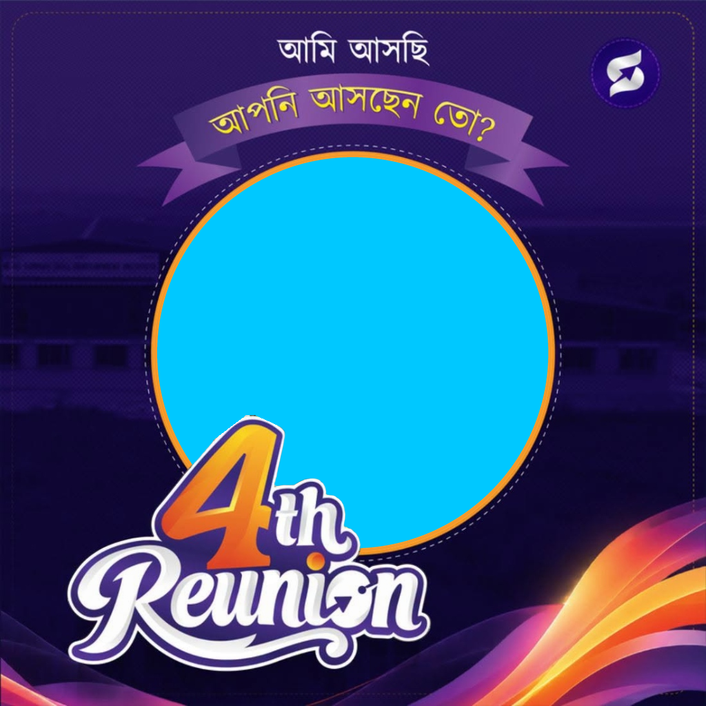

# ৪র্থ রিইউনিয়ন ক্যাম্পেইন পোস্টার জেনারেটর (Reunion DP Maker)

<p align="center">
  
</p>

একটি সম্পূর্ণ ক্লায়েন্ট-সাইড (Client-side) স্বয়ংক্রিয় ওয়েব অ্যাপ্লিকেশন। যেকোনো ব্যক্তি লিংকে প্রবেশ করে শুধু তার **নাম** ও **ছবি** আপলোড করলেই রিইউনিয়ন ফ্রেম ও পোস্টার স্বয়ংক্রিয়ভাবে তৈরি হয়ে যাবে এবং এক ক্লিকে হাই-রেজোলিউশন (1024x1024 HD) পোস্টার ডাউনলোড করতে পারবে।

---

## 🌟 প্রধান বৈশিষ্ট্যসমূহ (Features)

1. **অটোমেটিক সার্কেল মাস্কিং ও ফ্রেম ফিটিং:**
   - যেকোনো রেশিও-র ছবি আপলোড করা হোক না কেন, তা স্বয়ংক্রিয়ভাবে গোলাকার ফ্রেমে বসে যায়।
2. **ইন্টারেক্টিভ ড্র্যাগ ও জুম (Drag & Zoom Controls):**
   - প্রিভিউতে মাউস দিয়ে টেনে (বা মোবাইলে আঙুল দিয়ে সোয়াইপ করে) ছবি নিখুঁত পজিশনে সেট করা যায়।
   - জুম ও রোটেশন স্লাইডার দিয়ে ছবি বড়/ছোট বা সোজা করা যায়।
3. **স্মার্ট বাংলা ও ইংরেজি টাইপোগ্রাফি:**
   - ব্যবহারকারীর নাম এবং ব্যাচ/পদবী স্বয়ংক্রিয়ভাবে স্টাইলিশ ফন্ট ও প্রিমিয়াম গ্লাস-প্লেট ব্যাকগ্রাউন্ডে বসে যায়।
   - নামের পজিশন পরিবর্তন (Bottom Right / Bottom Center / Hide Name) করার সুবিধা।
4. **এক ক্লিকে HD ডাউনলোড:**
   - ফুল কোয়ালিটি ১০২৪×১০২৪ PNG ফাইল ডাউনলোড হয়।
5. **কোনো ডাটা স্টোরেজ বা সার্ভার খরচ নেই:**
   - ব্যবহারকারীর ছবি কোনো সার্ভারে জমা হয় না, সম্পূর্ণ কাজ ব্রাউজারের ভেতর HTML5 Canvas-এ নিরাপদভাবে সম্পন্ন হয়।

---

## 🚀 কীভাবে চালাবেন (How to Run)

### পদ্ধতি ১: সাধারণ ডাবল ক্লিক
সরাসরি `index.html` ফাইলটিতে ডাবল ক্লিক করে যেকোনো ব্রাউজারে (Chrome, Edge, Firefox, Safari) ওপেন করুন।

### পদ্ধতি ২: লোকাল সার্ভার (Local Server)
টার্মিনালে এই ফোল্ডারে এসে রান করুন:
```bash
python3 -m http.server 5500
```
এরপর ব্রাউজারে যান: `http://localhost:5500`

---

## 🌐 সবার জন্য অনলাইনে ফ্রি হোস্ট করার উপায় (Deploy Free)

আপনার ব্যাচমেট ও বন্ধুদের ব্যবহারের জন্য এটি অনলাইনে সম্পূর্ণ ফ্রিতে পাবলিশ করতে পারবেন:

### ১. GitHub Pages (সবচেয়ে সহজ):
1. এই রিপোজিটরিটির **Settings > Pages** এ যান।
2. **Build and deployment > Branch** এ `main` এবং `/ (root)` সিলেক্ট করে **Save** দিন।
3. ১-২ মিনিটের মধ্যে আপনার ফ্রি লাইভ সাইট চালু হয়ে যাবে:
   👉 `https://early-bird313.github.io/Reusable-Template/`

### ২. Vercel বা Netlify:
- [Vercel.com](https://vercel.com) বা [Netlify.com](https://netlify.com)-এ রিপোজিটরিটি কানেক্ট করলেই অটোমেটিক লাইভ লিংক তৈরি হয়ে যাবে।

---

## 📁 ফাইল স্ট্রাকচার

```
Reusable-Template/
│
├── index.html                  # প্রধান ইউজার ইন্টারফেস (UI)
├── style.css                   # প্রিমিয়াম ডার্ক/পার্পল থিম ও রেসপনসিভ সিএসএস
├── app.js                      # ক্যানভাস ড্রয়িং, ড্র্যাগ, জুম ও ডাউনলোড ইঞ্জিন
├── assets/
│   ├── template_frame.png      # নিখুঁত ট্রান্সপারেন্ট ফ্রেম ওভারলে (১০২৪x১০২৪)
│   ├── 4th_reunion_badge.png   # ৩ডি ৪থ রিইউনিয়ন লোগো (ট্রান্সপারেন্ট PNG)
│   ├── sample_original.jpg     # রেফারেন্স অরিজিনাল ডিজাইন
│   └── preview.png             # প্রিভিউ ডেমো ইমেজ
├── .gitignore                  # গিট ইগনোর কনফিগ
└── README.md                   # ব্যবহার নির্দেশিকা
```

---

## 🎨 ভবিষ্যতে ফ্রেম পরিবর্তন করতে চাইলে

গ্রাফিক্স ডিজাইনারের কাছ থেকে নতুন কোনো ফ্রেম পেলে:
1. ডিজাইনের মাঝের গোল অংশটি ট্রান্সপারেন্ট (ফাঁকা) রেখে **PNG** হিসেবে সেভ করুন।
2. ওয়েবসাইটের **"অ্যাডভান্সড: ফ্রেম পরিবর্তন করুন"** অপশন থেকে সরাসরি আপলোড করে তাৎক্ষণিক দেখতে পারবেন, অথবা `assets/template_frame.png` ফাইলটি রিপ্লেস করে দিলেই হবে।
